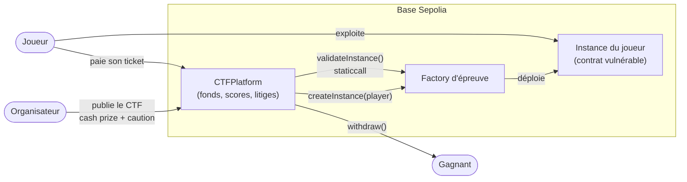

# Pwnpot

**Une plateforme ouverte de CTF smart contracts payants, sur Base Sepolia.**

N'importe qui peut publier un CTF. Chaque épreuve est un contrat volontairement vulnérable que le joueur doit exploiter : vider un coffre, devenir propriétaire, retrouver un mot de passe « caché ». Il n'y a pas de flag : c'est le contrat qui vérifie que l'exploit a réussi. La cagnotte, les tickets et les cautions sont détenus par le contrat `CTFPlatform`, qui n'a ni owner, ni proxy, ni fonction admin. Personne, ni la plateforme ni l'organisateur, ne peut les détourner.

> Projet du module *Blockchain & Decentralised Applications* (Epitech, Lucas Santoni). **Testnet uniquement**, aucun fond réel.

---

## Sommaire

1. [État d'avancement](#état-davancement)
2. [Comment ça marche](#comment-ça-marche)
3. [La feature décentralisée](#la-feature-décentralisée)
4. [Rôles et confiance](#rôles-et-confiance)
5. [Architecture : on-chain / off-chain](#architecture--on-chain--off-chain)
6. [Installation et commandes](#installation-et-commandes)
7. [Déploiement sur Base Sepolia](#déploiement-sur-base-sepolia)
8. [Adresses déployées](#adresses-déployées)
9. [Documentation détaillée](#documentation-détaillée)

---

## État d'avancement

| Partie | État |
| --- | --- |
| Frontend Next.js 16 + wagmi 3 (Base Sepolia, connexion wallet) | ✅ en place |
| Workspace Hardhat 3 (`contracts/`), keystore, réseau `baseSepolia` | ✅ en place |
| `CTFPlatform` (CTF, tickets, cautions, scores, retraits) | ⏳ à faire |
| Factories des 3 épreuves + tests d'exploit | ⏳ à faire |
| Litiges : vote + appel ERC-792 (`MockArbitrator`) | ⏳ à faire |
| Écrans du frontend (liste des CTF, jeu, litiges) | ⏳ à faire |
| Déploiement vérifié sur Basescan | ⏳ à faire |

> Le design ci-dessous est la cible. Les points encore ouverts sont listés dans [docs/DESIGN.md § Décisions à trancher](docs/DESIGN.md#décisions-à-trancher).

---

## Comment ça marche



1. **Création** : l'organisateur publie un CTF (une ou plusieurs épreuves, chacune avec sa factory). Il dépose le **cash prize** et une **caution**, et fixe le prix du ticket, le nombre maximum de joueurs et les dates.
2. **Inscription** : le joueur paie son ticket. Le montant s'ajoute à la cagnotte.
3. **Jeu** : pour chaque épreuve, le joueur demande **sa propre instance** du contrat vulnérable, puis l'exploite depuis son wallet ou avec son propre contrat d'attaque.
4. **Validation** : le joueur soumet. La plateforme demande à la factory si l'instance est résolue (`validateInstance`, appelé en `staticcall` avec une limite de gaz). Si oui, la réussite et son horodatage sont enregistrés on-chain.
5. **Fin** : après la deadline et une fenêtre de contestation, les gains sont crédités. Chacun appelle `withdraw()` (*pull payment*).
6. **Personne n'a réussi** : les tickets sont remboursés. L'organisateur récupère son cash prize et sa caution, mais ne gagne rien.
7. **Litige** : si un joueur soupçonne une triche de l'organisateur (solution fuitée à un complice, épreuve truquée), il ouvre un litige en déposant une caution. Les joueurs votent, puis le camp perdant peut faire appel à un arbitre ERC-792.

Le détail des phases, des flux d'argent et des règles est dans [docs/DESIGN.md](docs/DESIGN.md).

---

## La feature décentralisée

Les quatre points ci-dessous suivent la structure du test de décentralisation du module.

1. **La feature.** La cagnotte, les tickets et les cautions ne bougent que selon les règles du contrat, et la réussite d'une épreuve est vérifiée par du code public, pas par la parole de l'organisateur.
2. **La version centralisée.** Une plateforme avec une base de données et un administrateur pourrait encaisser les tickets et ne jamais payer. Elle pourrait aussi déclarer un faux gagnant, annuler un CTF après coup, geler un compte ou disparaître avec la cagnotte. Ici, aucune de ces actions n'existe dans le contrat.
3. **Qui est protégé.** Le joueur qui paie un ticket à un organisateur qu'il ne connaît pas. Il peut lire le code des épreuves et les règles de paiement **avant** de payer, et il sait que personne ne peut les changer ensuite.
4. **Ce qui reste trusted.**
   - **L'organisateur connaît les solutions** et peut les fuiter à un complice. Ce n'est pas prouvable on-chain. C'est dissuadé économiquement par sa caution, et contestable par un litige.
   - **Une factory est écrite par l'organisateur** : elle peut être truquée (validation qui refuse certains joueurs, porte dérobée). Les joueurs doivent lire le code vérifié avant de payer. Le litige couvre ce cas.
   - **Le vote des joueurs est intéressé** : les perdants ont intérêt à voter « triche », et l'organisateur peut acheter des tickets pour peser dans le vote. L'appel à l'arbitre corrige ces deux biais.
   - **L'arbitre**, fixé au déploiement, est trusted en appel, et seulement sur les fonds du litige.

> Pwnpot n'est pas « fully decentralised » : il réduit la confiance au minimum, rend sa trahison coûteuse, et l'écrit noir sur blanc.

---

## Rôles et confiance

| Rôle | Ce qu'il peut faire | S'il agit de mauvaise foi | S'il disparaît |
| --- | --- | --- | --- |
| **Organisateur** | Publier un CTF, choisir ses factories, déposer cash prize + caution | Fuiter une solution, publier une épreuve impossible ou truquée. **Limite :** il ne peut pas toucher aux fonds. Une épreuve impossible ne lui rapporte rien (tickets remboursés). Une triche prouvée par litige lui coûte sa caution. | Rien n'est bloqué : le CTF va jusqu'à sa deadline, puis les fonds sont distribués selon les règles. |
| **Joueur** | Payer un ticket, créer ses instances, soumettre, contester, voter | Contester à tort : il perd sa caution de contestation, versée à l'organisateur. Acheter plusieurs tickets pour peser dans un vote : coûteux, et corrigé par l'appel. | Aucun impact sur les autres. |
| **Votants** (détenteurs de tickets) | Trancher un litige en première instance | Voter par intérêt plutôt que sur les faits. Corrigé par l'appel. | Quorum non atteint : pas de sanction, le CTF se termine normalement. |
| **Arbitre** (ERC-792, `immutable`) | Trancher un litige **en appel uniquement** | Orienter les fonds **du litige** dans un sens ou dans l'autre. Il ne peut jamais toucher les fonds hors litige ni les autres CTF. | Après un timeout, la décision du vote s'applique. |
| **Factory d'épreuve** (code tiers) | Déployer une instance, répondre à `validateInstance` | Refuser la validation, consommer tout le gaz, tenter une réentrance. Mitigé par `staticcall` + limite de gaz + `nonReentrant`, le reste relève du litige. | Une factory qui revert bloque seulement son épreuve, jamais les fonds. |
| **Déployeur** | Déployer `CTFPlatform` et choisir l'arbitre | **Aucun pouvoir après le déploiement** : pas d'owner, pas de proxy, pas de pause. Son seul choix structurant est l'arbitre, visible par tous. | Aucun impact. |

---

## Architecture : on-chain / off-chain

| Où | Quoi | Pourquoi là |
| --- | --- | --- |
| **On-chain** (`CTFPlatform`) | Fonds (cash prize, tickets, cautions), inscriptions, instances par joueur, réussites horodatées, litiges, votes, crédits de retrait | C'est ce qui doit être impossible à modifier ou à détourner |
| **On-chain** (factories + instances) | Le code des épreuves et leur condition de réussite | La réussite doit être vérifiable par n'importe qui |
| **On-chain** (`MockArbitrator` / arbitre ERC-792) | Décisions d'appel | Interface standard, remplaçable par Kleros |
| **Off-chain** (frontend Next.js) | Affichage, construction des transactions, lecture des events | Ne détient **aucun état** : tout est relu depuis la chaîne |
| **Off-chain** (wallet du joueur) | Signature des transactions | Le frontend ne voit jamais une clé privée |

Il n'y a **aucun backend**. Si le frontend disparaît, tout reste utilisable depuis Basescan (*Write Contract*) ou un script viem.

**Stack**

- **Contrats** : Solidity 0.8.34, Hardhat 3 (toolbox viem, tests Solidity + `node:test`), OpenZeppelin 5.
- **Frontend** : Next.js 16 (App Router), React 19, TypeScript, Tailwind CSS v4, shadcn/ui (primitives Base UI).
- **Web3** : wagmi 3 + viem 2, connecteurs *injected* et Base Account.
- **Réseau** : Base Sepolia (chain id 84532) uniquement.
- **Paquets** : pnpm, en workspace (frontend à la racine, contrats dans `contracts/`).

```
app/ components/ hooks/ lib/   frontend Next.js
lib/onchain/wagmi.ts           config wagmi unique (Base Sepolia)
contracts/                     workspace Hardhat (@pwnpot/contracts)
  contracts/                   sources .sol + tests unitaires .t.sol
  test/                        tests d'intégration TypeScript
  ignition/modules/            modules de déploiement
docs/                          design, épreuves, sécurité
```

---

## Installation et commandes

Prérequis : Node.js ≥ 22 et pnpm.

```bash
git clone https://github.com/Victorbriez/Pwnpot.git
cd Pwnpot
pnpm install
cp .env.example .env.local      # puis renseigner l'adresse de CTFPlatform
```

| Commande | Effet |
| --- | --- |
| `pnpm dev` | Lance le frontend sur http://localhost:3000 |
| `pnpm build` | Build de production |
| `pnpm lint` / `pnpm typecheck` | ESLint / `tsc --noEmit` du frontend |
| `pnpm contracts:build` | Compile les contrats |
| `pnpm contracts:test` | Tests Solidity + TypeScript des contrats |
| `pnpm contracts:typecheck` | Compile puis vérifie les types des tests et scripts |

Variables du frontend (`.env.local`, aucune n'est secrète) :

| Variable | Rôle |
| --- | --- |
| `NEXT_PUBLIC_BASE_SEPOLIA_RPC_URL` | RPC Base Sepolia. Vide = RPC public |
| `NEXT_PUBLIC_CTF_PLATFORM_ADDRESS` | Adresse de `CTFPlatform` déployé |

---

## Déploiement sur Base Sepolia

Les secrets ne sont **jamais** dans un fichier : ils vont dans le keystore chiffré de Hardhat.

```bash
pnpm --filter @pwnpot/contracts exec hardhat keystore set BASE_SEPOLIA_RPC_URL
pnpm --filter @pwnpot/contracts exec hardhat keystore set BASE_SEPOLIA_PRIVATE_KEY
pnpm --filter @pwnpot/contracts exec hardhat keystore set ETHERSCAN_API_KEY

# déploiement (profil production, optimiseur activé)
pnpm --filter @pwnpot/contracts exec hardhat ignition deploy ignition/modules/<Module>.ts --network baseSepolia

# vérification sur Basescan, Blockscout et Sourcify
pnpm --filter @pwnpot/contracts exec hardhat ignition verify chain-84532 --network baseSepolia
```

- La clé de déploiement est celle d'un compte **dédié au testnet**, sans fonds réels.
- Le dossier `contracts/ignition/deployments/chain-84532/` est **committé** : c'est la trace de ce qui a été déployé, et où.
- Avant le code freeze, lancer `pnpm --filter @pwnpot/contracts exec hardhat test --build-profile production`, pour que les tests passent sur le bytecode réellement déployé.

---

## Adresses déployées

| Contrat | Adresse (Base Sepolia) |
| --- | --- |
| `CTFPlatform` | *à venir* |
| `MockArbitrator` | *à venir* |
| Factory « Coffre » (réentrance) | *à venir* |
| Factory « Usurpateur » (`tx.origin`) | *à venir* |
| Factory « Coffre-fort à code » (storage `private`) | *à venir* |

---

## Documentation détaillée

| Document | Contenu |
| --- | --- |
| [docs/DESIGN.md](docs/DESIGN.md) | Cycle de vie d'un CTF, flux d'argent, litiges et appel, réponse à chaque problématique, paramètres, décisions à trancher |
| [docs/CHALLENGES.md](docs/CHALLENGES.md) | Interface d'une épreuve, les 3 épreuves (faille, condition de réussite, exploit), comment en ajouter une |
| [docs/SECURITY.md](docs/SECURITY.md) | Modèle de menace : attaques possibles, parades, limites connues |
| [docs/FAILURES.md](docs/FAILURES.md) | Catalogue des failles du Day 3 : non applicable, traitée ou acceptée, avec le test associé |
| [contracts/README.md](contracts/README.md) | Travailler dans le workspace Hardhat |
| [DEMO.md](DEMO.md) | Scénario de la soutenance, pas à pas |
