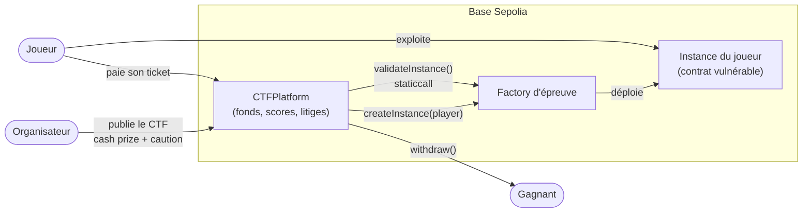

# Pwnpot

**Une plateforme ouverte de CTF smart contracts payants, sur Base Sepolia.**

N'importe qui peut publier un CTF. Chaque épreuve est un contrat volontairement vulnérable que le joueur doit exploiter : vider un coffre, devenir propriétaire, retrouver un mot de passe « caché ». Il n'y a pas de flag : c'est le contrat qui vérifie que l'exploit a réussi. La cagnotte, les tickets et les cautions sont détenus par le contrat `CTFPlatform`, qui n'a ni owner, ni proxy, ni fonction admin. Personne, ni la plateforme ni l'organisateur, ne peut les détourner.

> Projet du module _Blockchain & Decentralised Applications_ (Epitech, Lucas Santoni). **Testnet uniquement**, aucun fonds réel.

---

## Sommaire

1. [État d'avancement](#état-davancement)
2. [Comment ça marche](#comment-ça-marche)
3. [La feature décentralisée](#la-feature-décentralisée)
4. [Rôles et confiance](#rôles-et-confiance)
5. [Architecture : on-chain / off-chain](#architecture--on-chain--off-chain)
6. [Installation et commandes](#installation-et-commandes)
7. [Déploiement sur Base Sepolia](#déploiement-sur-base-sepolia)
8. [Adresses déployées](#adresses-déployées)
9. [Documentation détaillée](#documentation-détaillée)

---

## État d'avancement

| Partie                                                                                     | État                                                                                                                                                                                                              |
| ------------------------------------------------------------------------------------------ | ----------------------------------------------------------------------------------------------------------------------------------------------------------------------------------------------------------------- |
| Frontend Next.js 16 + wagmi 3, en ligne sur [pwnpot.vercel.app](https://pwnpot.vercel.app) | ✅ en place : lit et écrit dans `CTFPlatform` sur Base Sepolia                                                                                                                                                    |
| Workspace Hardhat 3 (`contracts/`), keystore, réseau `baseSepolia`                         | ✅ en place                                                                                                                                                                                                       |
| `CTFPlatform` (CTF, tickets, instances, scores, finalisation, remboursements, retraits)    | ✅ déployé et vérifié                                                                                                                                                                                             |
| Factories des 3 épreuves + tests d'exploit                                                 | ✅ en place : Usurpateur et Coffre-fort à code partagées, Coffre déployé par chaque organisateur                                                                                                                  |
| Écrans du frontend (explorer, création, jeu, classement, gains)                            | ✅ en place                                                                                                                                                                                                       |
| Tests d'attaque (factory malveillante, réentrance au retrait, bombe à gaz)                 | ✅ en place : `CTFPlatformAttacks.t.sol` ([#8](https://github.com/Victorbriez/Pwnpot/issues/8))                                                                                                                   |
| Factories hostiles (revert, données mal formées, factory à sec, écriture en validation)    | ✅ en place : `CTFPlatformFactories.t.sol` ([#20](https://github.com/Victorbriez/Pwnpot/issues/20))                                                                                                               |
| Litiges : contestation et arbitre ERC-792                                                  | ✅ version simplifiée : `openDispute` saisit directement l'arbitre, `rule` tranche, timeout de 7 j (15 min sur le déploiement de démo). Le vote des joueurs et l'appel ne sont pas implémentés (`NotImplemented`) |
| Déploiement sur Base Sepolia                                                               | ✅ deux déploiements du même code, réel (48 h) et démo (10 min, utilisé par le site), vérifiés sur Basescan et Sourcify ([adresses](#adresses-déployées))                                                         |
| Passe de sécurité (Slither, points d'entrée, couverture)                                   | ✅ faite avant le déploiement : [docs/SECURITY.md](docs/SECURITY.md#passe-de-sécurité-avant-déploiement) ([#22](https://github.com/Victorbriez/Pwnpot/issues/22))                                                 |
| Tests sur le bytecode déployé (profil production)                                          | ✅ dans la CI ([#21](https://github.com/Victorbriez/Pwnpot/issues/21))                                                                                                                                            |

Le plan jusqu'au code freeze, la répartition et les risques sont dans [docs/PLAN.md](docs/PLAN.md).

> Le design ci-dessous est la cible. Tout est déployé, avec des **litiges simplifiés** : la contestation part directement à l'arbitre, sans vote des joueurs ni appel (voir [docs/DESIGN.md § Litiges et appel](docs/DESIGN.md#litiges-et-appel)). Les choix de l'équipe sont résumés dans [docs/DESIGN.md § Décisions actées](docs/DESIGN.md#décisions-actées).

---

## Comment ça marche



1. **Création** : l'organisateur publie un CTF (une ou plusieurs épreuves, chacune avec sa factory). Il dépose le **cash prize** et une **caution** d'au moins `cashPrize + maxPlayers × ticketPrice`, et fixe le prix du ticket (minimum 0.0001 ETH), le nombre maximum de joueurs (1 à 200) et les dates.
2. **Inscription** : le joueur paie son ticket, un seul par adresse. Le montant s'ajoute à la cagnotte.
3. **Jeu** : pour chaque épreuve, le joueur demande **sa propre instance** du contrat vulnérable, puis l'exploite depuis son wallet ou avec son propre contrat d'attaque.
4. **Validation** : le joueur soumet. La plateforme demande à la factory si l'instance est résolue (`validateInstance`, appelé en `staticcall` avec une limite de gaz). Si oui, la réussite et son horodatage sont enregistrés on-chain.
5. **Fin** : après la deadline et une fenêtre de contestation de 48 h, cash prize et tickets sont crédités au podium (60 / 30 / 10 %). Chacun appelle `withdraw()` (_pull payment_).
6. **Personne n'a réussi** : les tickets sont remboursés. L'organisateur récupère son cash prize et sa caution, mais ne gagne rien.
7. **Litige** : si un joueur soupçonne une triche de l'organisateur (solution fuitée à un complice, épreuve truquée), il ouvre un litige pendant la contestation en déposant une caution et les frais d'arbitrage. Dans la version déployée, le litige part **directement à un arbitre ERC-792** (le design complet prévoit d'abord un vote des joueurs, puis un appel). Si la triche est confirmée, la caution de l'organisateur est brûlée, son cash prize lui est rendu et les tickets sont remboursés. Sans décision sous 7 jours, le litige est rejeté.

Le détail des phases, des flux d'argent et des règles est dans [docs/DESIGN.md](docs/DESIGN.md).

---

## La feature décentralisée

Les quatre points ci-dessous suivent la structure du test de décentralisation du module.

1. **La feature.** La cagnotte, les tickets et les cautions ne bougent que selon les règles du contrat, et la réussite d'une épreuve est vérifiée par du code public, pas par la parole de l'organisateur.
2. **La version centralisée.** Une plateforme avec une base de données et un administrateur pourrait encaisser les tickets et ne jamais payer. Elle pourrait aussi déclarer un faux gagnant, annuler un CTF après coup, geler un compte ou disparaître avec la cagnotte. Ici, aucune de ces actions n'existe dans le contrat.
3. **Qui est protégé.** Le joueur qui paie un ticket à un organisateur qu'il ne connaît pas. Il peut lire le code des épreuves et les règles de paiement **avant** de payer, et il sait que personne ne peut les changer ensuite.
4. **Ce qui reste trusted.**
   - **L'organisateur connaît les solutions** et peut les fuiter à un complice. Ce n'est pas prouvable on-chain. C'est dissuadé économiquement par sa caution, et contestable par un litige.
   - **Une factory est écrite par l'organisateur** : elle peut être truquée (validation qui refuse certains joueurs, porte dérobée). Les joueurs doivent lire le code vérifié avant de payer. Le litige couvre ce cas.
   - **L'arbitre**, fixé au déploiement, est trusted, et seulement sur les fonds du litige. Dans la version déployée, il tranche seul chaque litige ; en démo, c'est `MockArbitrator`, contrôlé par l'équipe.
   - _(Design complet)_ **Le vote des joueurs serait intéressé** : les perdants ont intérêt à voter « triche », et l'organisateur peut inscrire des complices (un ticket payant par adresse). L'appel à l'arbitre corrige ces deux biais.

> Pwnpot n'est pas « fully decentralised » : il réduit la confiance au minimum, rend sa trahison coûteuse, et l'écrit noir sur blanc.

---

## Rôles et confiance

> Litiges simplifiés dans le contrat déployé : l'**arbitre** tranche directement chaque litige, et son timeout rejette le litige. La ligne **Votants** décrit le design complet, non déployé.

| Rôle                                                | Ce qu'il peut faire                                                    | S'il agit de mauvaise foi                                                                                                                                                                                                                                                           | S'il disparaît                                                                                                         |
| --------------------------------------------------- | ---------------------------------------------------------------------- | ----------------------------------------------------------------------------------------------------------------------------------------------------------------------------------------------------------------------------------------------------------------------------------- | ---------------------------------------------------------------------------------------------------------------------- |
| **Organisateur**                                    | Publier un CTF, choisir ses factories, déposer cash prize + caution    | Fuiter une solution, publier une épreuve impossible ou truquée. **Limite :** il ne peut pas toucher aux fonds. Une épreuve impossible ne lui rapporte rien (tickets remboursés). Une triche prouvée par litige lui coûte sa caution, qui est brûlée (son cash prize lui est rendu). | Rien n'est bloqué : le CTF va jusqu'à sa deadline, puis les fonds sont distribués selon les règles.                    |
| **Joueur**                                          | Payer un ticket, créer ses instances, soumettre, contester             | Contester à tort : il perd sa caution de contestation, versée à l'organisateur. Multiplier les adresses : un ticket par adresse, au moins 0,0001 ETH chacun, donc coûteux.                                                                                                          | Aucun impact sur les autres.                                                                                           |
| _(Design complet)_ **Votants** (1 adresse = 1 voix) | Trancher un litige en première instance                                | Voter par intérêt plutôt que sur les faits. Corrigé par l'appel.                                                                                                                                                                                                                    | Quorum (max(3 votants, 20 % des tickets)) non atteint : résultat « pas de triche », le contestataire peut faire appel. |
| **Arbitre** (ERC-792, `immutable`)                  | Trancher chaque litige (directement ; en appel dans le design complet) | Orienter les fonds **du litige** dans un sens ou dans l'autre. Il ne peut jamais toucher les fonds hors litige ni les autres CTF.                                                                                                                                                   | Après le timeout, n'importe qui clôt le litige, qui est rejeté.                                                        |
| **Factory d'épreuve** (code tiers)                  | Déployer une instance, répondre à `validateInstance`                   | Refuser la validation, consommer tout le gaz, tenter une réentrance. Mitigé par `staticcall` + limite de gaz + `nonReentrant`, le reste relève du litige.                                                                                                                           | Une factory qui revert bloque seulement son épreuve, jamais les fonds.                                                 |
| **Déployeur**                                       | Déployer `CTFPlatform` et choisir l'arbitre                            | **Aucun pouvoir après le déploiement** : pas d'owner, pas de proxy, pas de pause. Son seul choix structurant est l'arbitre, visible par tous.                                                                                                                                       | Aucun impact.                                                                                                          |

---

## Architecture : on-chain / off-chain

| Où                                                | Quoi                                                                                                                         | Pourquoi là                                                                                                                                                   |
| ------------------------------------------------- | ---------------------------------------------------------------------------------------------------------------------------- | ------------------------------------------------------------------------------------------------------------------------------------------------------------- |
| **On-chain** (`CTFPlatform`)                      | Fonds (cash prize, tickets, cautions), inscriptions, instances par joueur, réussites horodatées, litiges, crédits de retrait | C'est ce qui doit être impossible à modifier ou à détourner                                                                                                   |
| **On-chain** (factories + instances)              | Le code des épreuves et leur condition de réussite                                                                           | La réussite doit être vérifiable par n'importe qui                                                                                                            |
| **On-chain** (`MockArbitrator` / arbitre ERC-792) | Décisions sur les litiges                                                                                                    | Interface standard ERC-792 : un autre arbitre (Kleros) demanderait quelques adaptations, voir [SECURITY.md](docs/SECURITY.md#brancher-un-vrai-arbitre-kleros) |
| **Off-chain** (frontend Next.js)                  | Affichage, construction des transactions, lecture des events                                                                 | Ne détient **aucun état** : tout est relu depuis la chaîne                                                                                                    |
| **Off-chain** (wallet du joueur)                  | Signature des transactions                                                                                                   | Le frontend ne voit jamais une clé privée                                                                                                                     |

Il n'y a **aucun backend**. Si le frontend disparaît, tout reste utilisable depuis Basescan (_Write Contract_) ou un script viem.

**Stack**

- **Contrats** : Solidity 0.8.34, Hardhat 3 (toolbox viem, tests Solidity + `node:test`), OpenZeppelin 5.
- **Frontend** : Next.js 16 (App Router), React 19, TypeScript, Tailwind CSS v4, shadcn/ui (primitives Base UI).
- **Web3** : wagmi 3 + viem 2, connecteurs _injected_ et Base Account.
- **Réseau** : Base Sepolia (chain id 84532) uniquement.
- **Paquets** : pnpm, en workspace (frontend à la racine, contrats dans `contracts/`).

```
app/ components/ hooks/ lib/   frontend Next.js
lib/onchain/wagmi.ts           config wagmi unique (Base Sepolia)
contracts/                     workspace Hardhat (@pwnpot/contracts)
  contracts/                   sources .sol + tests unitaires .t.sol
  test/                        tests d'intégration TypeScript
  ignition/modules/            modules de déploiement
docs/                          design, épreuves, sécurité
```

---

## Installation et commandes

Prérequis : Node.js ≥ 22.18 (les scripts `.ts` sont lancés directement par `node`) et pnpm.

```bash
git clone https://github.com/Victorbriez/Pwnpot.git
cd Pwnpot
pnpm install
cp .env.example .env.local      # valeurs du déploiement démo ; vider l'adresse pour le mode démo
```

| Commande                       | Effet                                                     |
| ------------------------------ | --------------------------------------------------------- |
| `pnpm dev`                     | Lance le frontend sur http://localhost:3000               |
| `pnpm build`                   | Build de production                                       |
| `pnpm start`                   | Sert le build de production en local (après `pnpm build`) |
| `pnpm lint` / `pnpm typecheck` | ESLint / `tsc --noEmit` du frontend                       |
| `pnpm contracts:build`         | Compile les contrats                                      |
| `pnpm contracts:test`          | Tests Solidity + TypeScript des contrats                  |
| `pnpm contracts:typecheck`     | Compile puis vérifie les types des tests et scripts       |

Variables du frontend (`.env.local`, aucune n'est secrète) :

| Variable                                | Rôle                                                                          |
| --------------------------------------- | ----------------------------------------------------------------------------- |
| `NEXT_PUBLIC_BASE_SEPOLIA_RPC_URL`      | RPC Base Sepolia. Vide = publicnode (events lus par tranches de 50 000 blocs) |
| `NEXT_PUBLIC_CTF_PLATFORM_ADDRESS`      | Adresse de `CTFPlatform` déployé                                              |
| `NEXT_PUBLIC_CTF_PLATFORM_DEPLOY_BLOCK` | Bloc de déploiement de `CTFPlatform` : les events sont lus à partir de là     |
| `NEXT_PUBLIC_IMPOSTOR_FACTORY_ADDRESS`  | Factory de l'Usurpateur (vide = épreuve non proposée à la création)           |
| `NEXT_PUBLIC_CODE_SAFE_FACTORY_ADDRESS` | Factory du Coffre-fort à code (idem)                                          |
| `NEXT_PUBLIC_TEST_FACTORY_ADDRESS`      | Factory de test sans exploit (Preview seulement, jamais en Production)        |
| `NEXT_PUBLIC_SITE_URL`                  | URL publique pour les liens absolus (facultatif sur Vercel)                   |

`pnpm contracts:env` affiche les valeurs du déploiement utilisé par le site (`DEPLOYMENT=<id>` pour un autre).

---

## Déploiement sur Base Sepolia

Les secrets ne sont **jamais** dans un fichier : ils vont dans le keystore chiffré de Hardhat.

```bash
pnpm --filter @pwnpot/contracts exec hardhat keystore set BASE_SEPOLIA_RPC_URL
pnpm --filter @pwnpot/contracts exec hardhat keystore set BASE_SEPOLIA_PRIVATE_KEY
pnpm --filter @pwnpot/contracts exec hardhat keystore set ETHERSCAN_API_KEY

# déploiement (profil production, optimiseur activé). Toujours un --deployment-id :
# sans lui, Ignition reprend chain-84532, le déploiement d'octobre.
# Raccourci pour le déploiement démo : pnpm contracts:deploy (puis pnpm contracts:verify).
pnpm --filter @pwnpot/contracts exec hardhat ignition deploy ignition/modules/Pwnpot.ts --network baseSepolia \
  --build-profile production --deployment-id <nouvel-id> [--parameters ignition/parameters/demo.json] --verify

# vérification sur Basescan, Blockscout et Sourcify. `verify` ne recompile pas :
# il compare avec les artefacts présents, qui doivent venir du profil production.
pnpm --filter @pwnpot/contracts exec hardhat build --build-profile production
pnpm --filter @pwnpot/contracts exec hardhat ignition verify <deployment-id> --network baseSepolia --build-profile production
```

- La clé de déploiement est celle d'un compte **dédié au testnet**, sans fonds réels.
- Les dossiers `contracts/ignition/deployments/` sont **committés** : c'est la trace de ce qui a été déployé, et où (`pwnpot-disputes`, `pwnpot-disputes-demo`, et `chain-84532` pour le déploiement d'octobre). Pour un nouveau déploiement, passer un nouveau `--deployment-id` : Ignition refuse de redéployer un module dont le code a changé sous le même identifiant.
- Les tests tournent aussi sur le bytecode optimisé, celui de `CTFPlatform` et des factories partagées déployées (le Coffre, lui, est déployé depuis le site avec le profil par défaut, que couvrent les tests habituels) : `pnpm --filter @pwnpot/contracts exec hardhat test --build-profile production`. La CI lance cette commande sur chaque PR.

---

## Adresses déployées

Deux déploiements du même code (litiges simplifiés), le 26 nov 2026. Seules les durées du litige changent (`immutable`, fixées au constructeur).

| Contrat                                            | Réel : 48 h de contestation, 7 j d'arbitre (`pwnpot-disputes`)                                                                       | Démo : 10 min de contestation, 15 min d'arbitre (`pwnpot-disputes-demo`)                                                             |
| -------------------------------------------------- | ------------------------------------------------------------------------------------------------------------------------------------ | ------------------------------------------------------------------------------------------------------------------------------------ |
| `CTFPlatform`                                      | [`0x339a160071730DfbfB50EFC95b546Ca86e50bb22`](https://sepolia.basescan.org/address/0x339a160071730DfbfB50EFC95b546Ca86e50bb22#code) | [`0xb701e1c29F0cA0F237414a4F395Ed1f04e9fbf60`](https://sepolia.basescan.org/address/0xb701e1c29F0cA0F237414a4F395Ed1f04e9fbf60#code) |
| Bloc de déploiement                                | `63929184`                                                                                                                           | `63922316`                                                                                                                           |
| `MockArbitrator`                                   | [`0xD12289EFA71C4342815C72afCDb90F7Ba625C63c`](https://sepolia.basescan.org/address/0xD12289EFA71C4342815C72afCDb90F7Ba625C63c#code) | [`0x424daD72E083dD0011DC7F098A18b27692E9870D`](https://sepolia.basescan.org/address/0x424daD72E083dD0011DC7F098A18b27692E9870D#code) |
| `TestLevel` (factory de test, sans exploit)        | [`0x2A18C875a347fbA2F82F4a4eCB7E1925a378280f`](https://sepolia.basescan.org/address/0x2A18C875a347fbA2F82F4a4eCB7E1925a378280f#code) | [`0x06fc0de322568B78650b40364Abb15936bBd1254`](https://sepolia.basescan.org/address/0x06fc0de322568B78650b40364Abb15936bBd1254#code) |
| Factory « Coffre » (réentrance)                    | une par CTF : déployée, alimentée et liée par l'organisateur depuis le formulaire de création                                        | idem                                                                                                                                 |
| Factory « Usurpateur » (`tx.origin`)               | [`0x08d999619d1f19F24bad5fd3ca65D0265258ECD9`](https://sepolia.basescan.org/address/0x08d999619d1f19F24bad5fd3ca65D0265258ECD9#code) | [`0x75561314e7A13132C2181de3A9Af063e5a57440e`](https://sepolia.basescan.org/address/0x75561314e7A13132C2181de3A9Af063e5a57440e#code) |
| Factory « Coffre-fort à code » (storage `private`) | [`0x24ee1Dd643d60D98b45373c159713f84a333DbAc`](https://sepolia.basescan.org/address/0x24ee1Dd643d60D98b45373c159713f84a333DbAc#code) | [`0x029824C81B59de62D874d89dfDBFD8517708c7f0`](https://sepolia.basescan.org/address/0x029824C81B59de62D874d89dfDBFD8517708c7f0#code) |

Le `ruler` des deux `MockArbitrator` (le compte qui rend les décisions) est le compte de déploiement `0xA469B2A79DD89792D71921F987Dfdc0b189466ad`. Le premier déploiement, d'octobre, sans litiges (`CTFPlatform` `0x3F9745Fd1d01c6FAf91f4B5FE96241712788A2b1`), reste dans `contracts/ignition/deployments/chain-84532/` pour mémoire.

---

## Documentation détaillée

| Document                                   | Contenu                                                                                                              |
| ------------------------------------------ | -------------------------------------------------------------------------------------------------------------------- |
| [docs/DESIGN.md](docs/DESIGN.md)           | Cycle de vie d'un CTF, flux d'argent, litiges et appel, réponse à chaque problématique, paramètres, décisions actées |
| [docs/CHALLENGES.md](docs/CHALLENGES.md)   | Interface d'une épreuve, les 3 épreuves (faille, condition de réussite, exploit), comment en ajouter une             |
| [docs/SECURITY.md](docs/SECURITY.md)       | Modèle de menace : attaques possibles, parades, limites connues                                                      |
| [docs/FAILURES.md](docs/FAILURES.md)       | Catalogue des failles du Day 3 : non applicable, traitée ou acceptée, avec le test associé                           |
| [docs/THE-DAO.md](docs/THE-DAO.md)         | Post-mortem de The DAO (2016) : la réentrance qui l'a vidée, et ce que Pwnpot fait différemment                      |
| [docs/PLAN.md](docs/PLAN.md)               | Ce qui reste jusqu'au code freeze, répartition par membre, risques et plans B                                        |
| [contracts/README.md](contracts/README.md) | Travailler dans le workspace Hardhat                                                                                 |
| [DEMO.md](DEMO.md)                         | Scénario de la soutenance, pas à pas                                                                                 |
