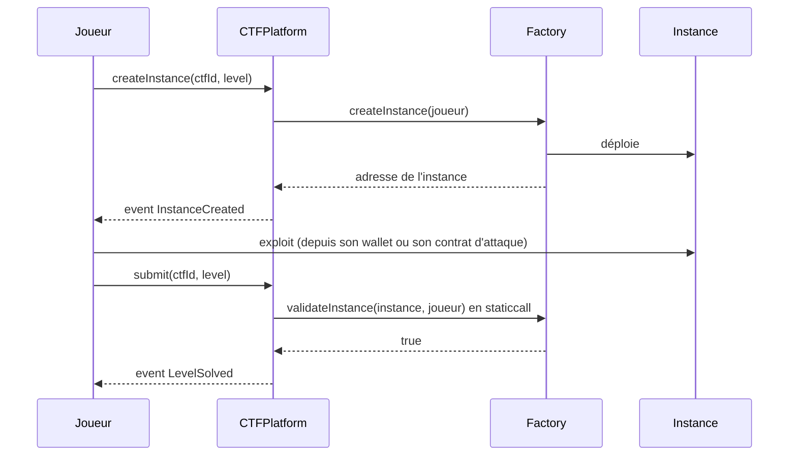

# Les épreuves

Une épreuve Pwnpot, c'est un contrat volontairement vulnérable, plus une **factory** qui en déploie une copie par joueur et qui sait dire si cette copie a été exploitée. Il n'y a pas de flag : la réussite se lit dans l'état de la chaîne. C'est le même principe qu'[Ethernaut](https://ethernaut.openzeppelin.com/).

> Les noms et le code ci-dessous sont des esquisses. Ils seront remplacés par le code réel de `contracts/contracts/levels/`.

## Sommaire

1. [Interface d'une épreuve](#interface-dune-épreuve)
2. [Pourquoi une instance par joueur](#pourquoi-une-instance-par-joueur)
3. [Épreuve 1 — Coffre (réentrance)](#épreuve-1--coffre-réentrance)
4. [Épreuve 2 — Usurpateur (`tx.origin`)](#épreuve-2--usurpateur-txorigin)
5. [Épreuve 3 — Coffre-fort à code (storage `private`)](#épreuve-3--coffre-fort-à-code-storage-private)
6. [Ajouter une épreuve](#ajouter-une-épreuve)
7. [Ce qu'un joueur doit vérifier avant de payer](#ce-quun-joueur-doit-vérifier-avant-de-payer)

---

## Interface d'une épreuve

```solidity
interface ILevel {
    /// Déploie une instance vulnérable pour `player`. Appelée par CTFPlatform uniquement.
    function createInstance(address player) external returns (address instance);

    /// Vrai si `instance` a été exploitée. Doit être `view` :
    /// CTFPlatform l'appelle en staticcall avec une limite de gaz.
    function validateInstance(address instance, address player) external view returns (bool);
}
```



La plateforme enregistre l'instance de chaque joueur au moment de sa création. `submit` ne valide **que** l'instance de `msg.sender` : personne ne peut soumettre à la place d'un autre.

---

## Pourquoi une instance par joueur

- **Pas de sabotage.** Si tout le monde attaquait le même coffre, le premier à le vider le viderait pour tous.
- **Pas de vol de réussite.** Comme la réussite est liée à l'instance du joueur, rejouer la transaction d'un autre ne valide rien pour soi.
- **Ce qu'on ne peut pas empêcher.** Une fois sur la chaîne, l'exploit d'un joueur est public : son contrat d'attaque et ses transactions sont lisibles par tous. Un autre joueur peut le recopier contre sa propre instance. Il le fera forcément **plus tard**, et le classement départage au temps. C'est une limite assumée de toute épreuve on-chain.

---

## Épreuve 1 — Coffre (réentrance)

**La faille.** `withdraw` envoie l'ETH **avant** de remettre le solde à zéro. Un contrat d'attaque peut donc rappeler `withdraw` depuis son `receive()` et vider le coffre.

```solidity
contract Vault {
    uint256 public immutable initialBalance;
    mapping(address account => uint256 amount) public balances;
    bool public drained;   // ne revient jamais à false

    constructor() payable { initialBalance = msg.value; }   // alimenté par la factory

    function deposit() external payable { balances[msg.sender] += msg.value; }

    function withdraw() external {
        uint256 amount = balances[msg.sender];
        (bool ok, ) = msg.sender.call{value: amount}("");   // interaction AVANT l'effet
        require(ok);
        if (address(this).balance == 0) drained = true;     // résolu pour de bon
        balances[msg.sender] = 0;
    }
}
```

**Condition de réussite.** `initialBalance > 0 && drained`, où `initialBalance` est le solde enregistré par l'instance à sa création et `drained` un drapeau définitif posé par `withdraw` quand il laisse le coffre vide. Inutile de relire le solde : l'ETH ne peut sortir du coffre que par `withdraw`, qui pose `drained` dès qu'il le vide. L'instance doit aussi avoir été créée par la factory pour ce joueur.

**Exploit attendu.** Le joueur déploie un contrat d'attaque, fait un petit dépôt, puis appelle `withdraw`. Son `receive()` rappelle `withdraw` tant que le coffre n'est pas vide. Pour que le coffre finisse exactement à 0, le dépôt est égal au solde du coffre lu dans la même transaction : deux retraits le vident (exemple de test : `contracts/contracts/exploits/VaultAttack.sol`, qui accepte une marge et rend l'excédent).

**Ce que ça enseigne.** Checks-effects-interactions, et pourquoi `CTFPlatform` remet les soldes à zéro avant de payer (voir [SECURITY.md](SECURITY.md)).

**Point de conception.** Le solde des coffres est géré par la factory, pas par `CTFPlatform`, qui reste générique.

- L'organisateur déploie `VaultFactory` et **l'alimente** avec `maxPlayers × 0.0001 ETH` (`SEED`, constante). Chaque instance démarre avec 0.0001 ETH.
- Après `createCTF`, l'organisateur appelle **`bind(ctfId)`** une seule fois : la factory vérifie sur `CTFPlatform` qu'il est bien l'organisateur de ce CTF, que celui-ci la liste **une seule fois** parmi ses épreuves, et qu'elle détient déjà `maxPlayers × SEED` (sinon `InsufficientFunds`).
- `createInstance` n'accepte que `CTFPlatform`, et seulement pour un joueur qui a un ticket dans le CTF lié, pendant sa phase `Running`, **une instance par joueur**. Quelqu'un qui reprend la factory dans son propre CTF ne peut donc pas vider ses fonds : il y a au plus `maxPlayers` coffres.
- `createInstance` **revert** (`InsufficientFunds`) si la factory ne peut plus alimenter une nouvelle instance. Grâce au contrôle de `bind` et au blocage de `recover()` pendant le CTF, ça ne devrait pas arriver.
- L'instance **enregistre son solde initial**. La condition de réussite devient « solde initial > 0 **et** coffre vidé ». Sans ça, un coffre jamais alimenté serait « résolu » sans exploit.
- Ce que le joueur vide, il le garde. Une fois le CTF terminé, dans les phases `Contestation`, `Finalized` ou `Cheated` uniquement (pas pendant un litige : `Voting`, `AppealWindow`, `Appealed`), l'organisateur, et lui seul, récupère le reste avec **`recover()`**. Avant `bind`, aucun coffre ne peut exister : `recover()` est alors possible à tout moment.
- L'ETH resté dans un coffre jamais vidé y reste : l'organisateur ne peut pas le récupérer, seul quelqu'un qui exploite le coffre peut le prendre (au plus 0.0001 ETH par instance non résolue).

**Limites connues.**

- Si l'organisateur n'appelle pas `bind(ctfId)` avant le début du CTF, `createInstance` revert (`NotBound`) : l'épreuve est injouable tant que ce n'est pas fait.
- Forcer l'envoi de quelques wei (`selfdestruct`) vers un coffre **déjà vidé** ne le rend plus « non résolu » : dès qu'un `withdraw` laisse le coffre à 0, il passe `drained = true`, et ce drapeau ne revient jamais à `false`. Avant le premier vidage, un rival peut encore envoyer quelques wei juste avant l'exploit ; un contrat d'attaque qui dépose le solde lu dans la même transaction (comme `VaultAttack`) vide quand même le coffre, alors qu'un dépôt calculé à l'avance peut laisser un reste ou échouer.
- N'importe qui peut vider le coffre d'un autre joueur, et la réussite compte pour le **propriétaire** du coffre, pas pour celui qui l'a vidé. Un complice peut donc résoudre l'épreuve à la place d'un joueur. C'est équivalent à lui donner l'exploit, limite déjà assumée (exploits recopiables, voir [DESIGN.md](DESIGN.md#problématiques-et-réponses)).
- La factory ne sait pas quel CTF l'appelle : elle tient **un coffre par joueur**, tous CTF confondus. Un joueur qui crée d'abord son coffre via un autre CTF listant la même factory ne peut plus en créer dans le CTF lié (`AlreadyHasInstance`). Seul ce joueur est pénalisé, et c'est cette limite qui garantit que le financement suffit.

---

## Épreuve 2 — Usurpateur (`tx.origin`)

**La faille.** Le contrat croit authentifier le propriétaire avec `tx.origin`, mais `tx.origin` désigne le wallet qui a lancé la transaction, pas l'appelant direct. Un contrat intermédiaire suffit à contourner la vérification.

```solidity
contract Impostor {
    address public immutable player;   // joueur pour qui l'instance a été créée
    address public owner;

    constructor(address initialOwner, address player_) {
        owner = initialOwner;
        player = player_;
    }

    function changeOwner(address newOwner) external {
        // tx.origin != msg.sender : vrai dès qu'un contrat sert d'intermédiaire
        if (tx.origin == player && tx.origin != msg.sender) {
            owner = newOwner;
        }
    }
}
```

**Condition de réussite.** `Impostor(instance).owner() == player`, sur une instance créée par la factory pour ce joueur.

**Exploit attendu.** Le joueur déploie un contrat qui appelle `changeOwner(joueur)`. Dans cet appel, `msg.sender` est le contrat et `tx.origin` est le joueur : la condition passe.

**Ce que ça enseigne.** On authentifie toujours avec `msg.sender`, jamais avec `tx.origin`.

**Point de conception.** La factory est le propriétaire de départ de chaque instance : une instance neuve ne valide donc jamais. Chaque instance enregistre son joueur et `changeOwner` exige `tx.origin == player` : sans cette condition, un concurrent pourrait passer par son propre contrat d'attaque pour réécrire le propriétaire de l'instance d'un autre, entre son exploit et son `submit`, et l'empêcher de valider. La faille enseignée reste la même : depuis son wallet, l'appel échoue ; via un contrat, il passe.

---

## Épreuve 3 — Coffre-fort à code (storage `private`)

**La faille.** `private` empêche seulement les autres contrats de lire la variable. Tout le storage reste lisible par n'importe qui qui interroge un nœud.

```solidity
contract CodeSafe {
    bool public locked = true;
    bytes32 private password;          // slot 1 : lisible avec eth_getStorageAt

    constructor(bytes32 _password) { password = _password; }

    function unlock(bytes32 attempt) external {
        if (attempt == password) locked = false;
    }
}
```

**Condition de réussite.** `CodeSafe(instance).locked() == false`

**Exploit attendu.** Le joueur lit le slot 1 de son instance (`cast storage`, `eth_getStorageAt` ou `publicClient.getStorageAt` avec viem), puis appelle `unlock` avec la valeur lue.

**Ce que ça enseigne.** « Il n'y a pas de secret sur une chaîne. » C'est aussi pour ça que Pwnpot n'utilise pas de flag stocké on-chain.

**Point de conception.** Le mot de passe est `keccak256(joueur, blockhash(block.number - 1), factory, compteur d'instances)` : il est différent dans chaque instance, et le copier d'une autre instance ne sert donc à rien. Il n'a pas besoin d'être imprévisible, puisqu'il est lisible de toute façon. Seule `CTFPlatform` (adresse fixée au déploiement de la factory) peut créer une instance, et `validateInstance` ne valide que l'instance créée pour ce joueur.

---

## Ajouter une épreuve

1. Écrire le contrat vulnérable et sa factory dans `contracts/contracts/levels/`, en implémentant `ILevel`.
2. `validateInstance` doit être **`view`** et rester **sous la limite de gaz** de la plateforme (`VALIDATION_GAS` = 300 000 dans `CTFPlatform`).
3. Écrire un **test d'exploit** dans `contracts/test/` qui :
   - crée une instance ;
   - vérifie que `validateInstance` renvoie `false` ;
   - joue l'exploit ;
   - vérifie que `validateInstance` renvoie `true`.
4. Écrire un **test négatif** : un joueur qui n'a pas exploité son instance ne peut pas valider, et l'instance d'un autre joueur ne compte pas pour lui.
5. Déployer la factory, puis la **vérifier sur Basescan**. Une factory non vérifiée ne devrait pas être jouée.
6. Documenter l'épreuve dans ce fichier : faille, condition de réussite, exploit attendu.

---

## Ce qu'un joueur doit vérifier avant de payer

Les factories sont écrites par les organisateurs : elles ne sont **pas fiables par défaut**. Avant d'acheter un ticket, un joueur prudent vérifie que :

- le code de chaque factory est **vérifié** sur Basescan ;
- `validateInstance` lit seulement l'état de l'instance, sans exception par adresse, sans porte dérobée et sans dépendance à une variable que l'organisateur pourrait modifier ;
- la factory n'est **pas un proxy** (pas de `delegatecall` vers une implémentation remplaçable) ;
- le `codehash` enregistré par la plateforme à la création du CTF correspond bien au code lu.

Si une épreuve est truquée malgré tout, le recours est le [litige](DESIGN.md#litiges-et-appel).
