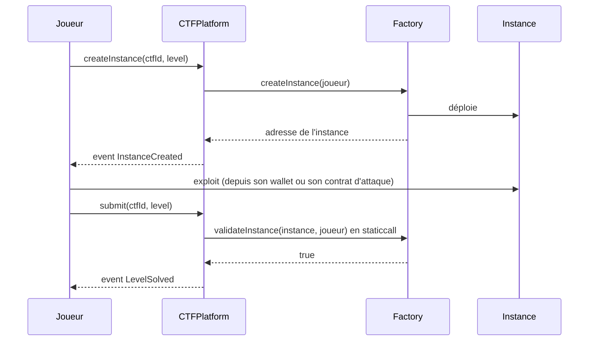

# Les épreuves

Une épreuve Pwnpot, c'est un contrat volontairement vulnérable, plus une **factory** qui en déploie une copie par joueur et qui sait dire si cette copie a été exploitée. Il n'y a pas de flag : la réussite se lit dans l'état de la chaîne. C'est le même principe qu'[Ethernaut](https://ethernaut.openzeppelin.com/).

> Les noms et le code ci-dessous sont des esquisses. Ils seront remplacés par le code réel de `contracts/contracts/levels/`.

## Sommaire

1. [Interface d'une épreuve](#interface-dune-épreuve)
2. [Pourquoi une instance par joueur](#pourquoi-une-instance-par-joueur)
3. [Épreuve 1 — Coffre (réentrance)](#épreuve-1--coffre-réentrance)
4. [Épreuve 2 — Usurpateur (`tx.origin`)](#épreuve-2--usurpateur-txorigin)
5. [Épreuve 3 — Coffre-fort à code (storage `private`)](#épreuve-3--coffre-fort-à-code-storage-private)
6. [Ajouter une épreuve](#ajouter-une-épreuve)
7. [Ce qu'un joueur doit vérifier avant de payer](#ce-quun-joueur-doit-vérifier-avant-de-payer)

---

## Interface d'une épreuve

```solidity
interface ILevel {
    /// Déploie une instance vulnérable pour `player`. Appelée par CTFPlatform uniquement.
    function createInstance(address player) external returns (address instance);

    /// Vrai si `instance` a été exploitée. Doit être `view` :
    /// CTFPlatform l'appelle en staticcall avec une limite de gaz.
    function validateInstance(address instance, address player) external view returns (bool);
}
```



La plateforme enregistre l'instance de chaque joueur au moment de sa création. `submit` ne valide **que** l'instance de `msg.sender` : personne ne peut soumettre à la place d'un autre.

---

## Pourquoi une instance par joueur

- **Pas de sabotage.** Si tout le monde attaquait le même coffre, le premier à le vider le viderait pour tous.
- **Pas de vol de réussite.** Comme la réussite est liée à l'instance du joueur, rejouer la transaction d'un autre ne valide rien pour soi.
- **Ce qu'on ne peut pas empêcher.** Une fois sur la chaîne, l'exploit d'un joueur est public : son contrat d'attaque et ses transactions sont lisibles par tous. Un autre joueur peut le recopier contre sa propre instance. Il le fera forcément **plus tard**, et le classement départage au temps. C'est une limite assumée de toute épreuve on-chain.

---

## Épreuve 1 — Coffre (réentrance)

**La faille.** `withdraw` envoie l'ETH **avant** de remettre le solde à zéro. Un contrat d'attaque peut donc rappeler `withdraw` depuis son `receive()` et vider le coffre.

```solidity
contract Vault {
    mapping(address => uint256) public balances;

    function deposit() external payable { balances[msg.sender] += msg.value; }

    function withdraw() external {
        uint256 amount = balances[msg.sender];
        (bool ok, ) = msg.sender.call{value: amount}("");   // interaction AVANT l'effet
        require(ok);
        balances[msg.sender] = 0;
    }
}
```

**Condition de réussite.** `address(instance).balance == 0`

**Exploit attendu.** Le joueur déploie un contrat d'attaque, fait un petit dépôt, puis appelle `withdraw`. Son `receive()` rappelle `withdraw` tant que le coffre n'est pas vide.

**Ce que ça enseigne.** Checks-effects-interactions, et pourquoi `CTFPlatform` remet les soldes à zéro avant de payer (voir [SECURITY.md](SECURITY.md)).

**Point de conception.** Chaque instance démarre avec un petit solde (par exemple 0.0001 ETH) fourni par la factory, que l'organisateur alimente à la création du CTF. Le montant exact reste *à trancher*.

---

## Épreuve 2 — Usurpateur (`tx.origin`)

**La faille.** Le contrat croit authentifier le propriétaire avec `tx.origin`, mais `tx.origin` désigne le wallet qui a lancé la transaction, pas l'appelant direct. Un contrat intermédiaire suffit à contourner la vérification.

```solidity
contract Impostor {
    address public owner;

    constructor(address initialOwner) { owner = initialOwner; }

    function changeOwner(address newOwner) external {
        if (tx.origin != msg.sender) {   // vrai dès qu'un contrat sert d'intermédiaire
            owner = newOwner;
        }
    }
}
```

**Condition de réussite.** `Impostor(instance).owner() == player`

**Exploit attendu.** Le joueur déploie un contrat qui appelle `changeOwner(joueur)`. Dans cet appel, `msg.sender` est le contrat et `tx.origin` est le joueur : la condition passe.

**Ce que ça enseigne.** On authentifie toujours avec `msg.sender`, jamais avec `tx.origin`.

---

## Épreuve 3 — Coffre-fort à code (storage `private`)

**La faille.** `private` empêche seulement les autres contrats de lire la variable. Tout le storage reste lisible par n'importe qui qui interroge un nœud.

```solidity
contract CodeSafe {
    bool public locked = true;
    bytes32 private password;          // slot 1 : lisible avec eth_getStorageAt

    constructor(bytes32 _password) { password = _password; }

    function unlock(bytes32 attempt) external {
        if (attempt == password) locked = false;
    }
}
```

**Condition de réussite.** `CodeSafe(instance).locked() == false`

**Exploit attendu.** Le joueur lit le slot 1 de son instance (`cast storage`, `eth_getStorageAt` ou `publicClient.getStorageAt` avec viem), puis appelle `unlock` avec la valeur lue.

**Ce que ça enseigne.** « Il n'y a pas de secret sur une chaîne. » C'est aussi pour ça que Pwnpot n'utilise pas de flag stocké on-chain.

**Point de conception.** Le mot de passe est dérivé de l'adresse du joueur et d'une valeur pseudo-aléatoire, pour être différent dans chaque instance. Le copier d'une autre instance ne sert donc à rien.

---

## Ajouter une épreuve

1. Écrire le contrat vulnérable et sa factory dans `contracts/contracts/levels/`, en implémentant `ILevel`.
2. `validateInstance` doit être **`view`** et rester **sous la limite de gaz** de la plateforme (300 000 *(proposé)*).
3. Écrire un **test d'exploit** dans `contracts/test/` qui :
   - crée une instance ;
   - vérifie que `validateInstance` renvoie `false` ;
   - joue l'exploit ;
   - vérifie que `validateInstance` renvoie `true`.
4. Écrire un **test négatif** : un joueur qui n'a pas exploité son instance ne peut pas valider, et l'instance d'un autre joueur ne compte pas pour lui.
5. Déployer la factory, puis la **vérifier sur Basescan**. Une factory non vérifiée ne devrait pas être jouée.
6. Documenter l'épreuve dans ce fichier : faille, condition de réussite, exploit attendu.

---

## Ce qu'un joueur doit vérifier avant de payer

Les factories sont écrites par les organisateurs : elles ne sont **pas fiables par défaut**. Avant d'acheter un ticket, un joueur prudent vérifie que :

- le code de chaque factory est **vérifié** sur Basescan ;
- `validateInstance` lit seulement l'état de l'instance, sans exception par adresse, sans porte dérobée et sans dépendance à une variable que l'organisateur pourrait modifier ;
- la factory n'est **pas un proxy** (pas de `delegatecall` vers une implémentation remplaçable) ;
- le `codehash` enregistré par la plateforme à la création du CTF correspond bien au code lu.

Si une épreuve est truquée malgré tout, le recours est le [litige](DESIGN.md#litiges-et-appel).
