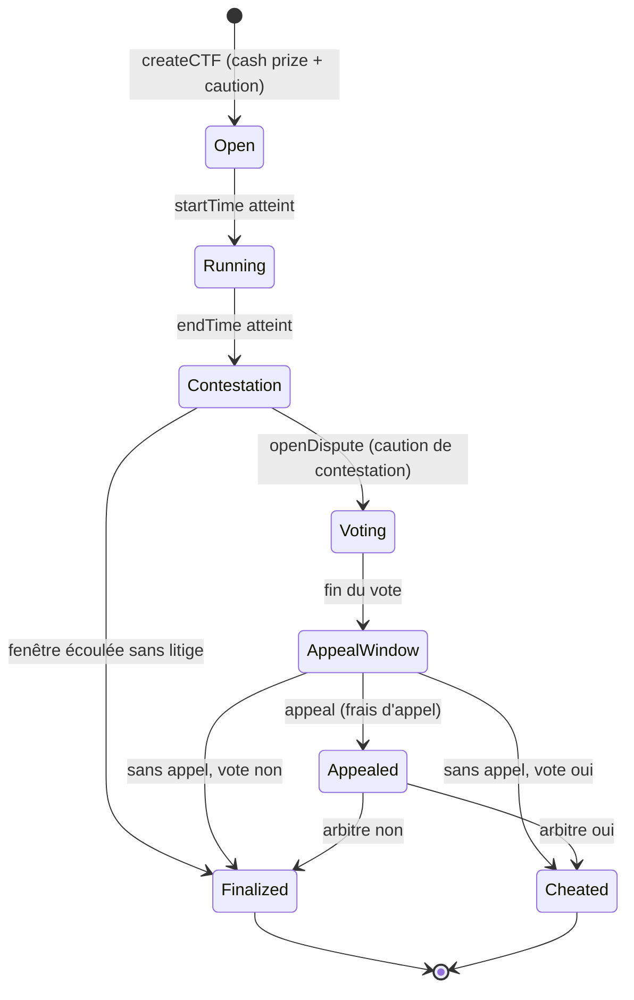
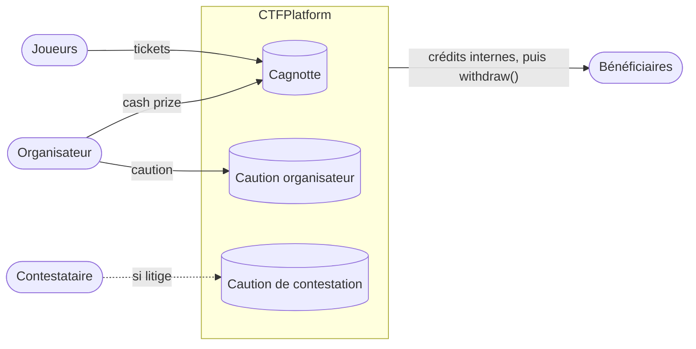
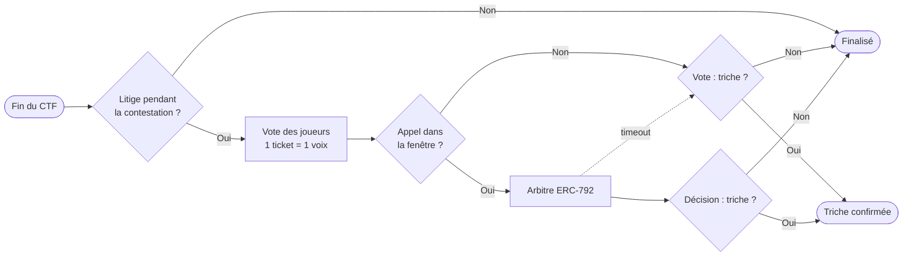

# Design de Pwnpot

Ce document décrit le fonctionnement complet de la plateforme : le cycle de vie d'un CTF, où va l'argent, comment les litiges sont tranchés, et comment le design répond à chaque problème connu. Les valeurs marquées *(proposé)* ne sont pas encore figées ; voir [Décisions à trancher](#décisions-à-trancher).

## Sommaire

1. [Acteurs](#acteurs)
2. [Cycle de vie d'un CTF](#cycle-de-vie-dun-ctf)
3. [Flux d'argent](#flux-dargent)
4. [Score et classement](#score-et-classement)
5. [Litiges et appel](#litiges-et-appel)
6. [Problématiques et réponses](#problématiques-et-réponses)
7. [Paramètres](#paramètres)
8. [Interface du contrat (cible)](#interface-du-contrat-cible)
9. [Décisions à trancher](#décisions-à-trancher)

---

## Acteurs

| Acteur | Description |
| --- | --- |
| **Organisateur** | Publie un CTF, fournit les factories des épreuves, dépose le cash prize et une caution |
| **Joueur** | Paie un ticket, exploite ses instances, soumet ses réussites, peut contester et voter |
| **Arbitre** | Contrat ERC-792 fixé au déploiement de `CTFPlatform` (`immutable`). `MockArbitrator` pour les tests et la démo, Kleros en extension |
| **N'importe qui** | Peut déclencher les transitions liées au temps (clôture, finalisation, application d'un timeout) : aucune étape ne dépend d'un acteur précis |

---

## Cycle de vie d'un CTF



| Phase | Ce qui est possible | Qui déclenche la sortie |
| --- | --- | --- |
| `Open` | Acheter un ticket | Le temps (`startTime`) |
| `Running` | Acheter un ticket (jusqu'à `maxPlayers`), créer ses instances, soumettre ses réussites | Le temps (`endTime`) |
| `Contestation` | Ouvrir un litige | Le temps : n'importe qui appelle `finalize` |
| `Voting` | Voter (détenteurs de tickets) | Le temps |
| `AppealWindow` | Faire appel | Le temps |
| `Appealed` | L'arbitre rend sa décision (`rule`) | L'arbitre, ou le timeout : sans réponse, le résultat du vote s'applique |
| `Finalized` / `Cheated` | Retirer ce qui est dû (`withdraw`) | — |

Toutes les transitions liées au temps sont **appelables par n'importe qui**. Si l'organisateur disparaît, le CTF se termine quand même.

---

## Flux d'argent



L'argent ne sort **jamais** par un transfert automatique : chaque issue **crédite un solde interne** (`owed[address]`), puis chacun appelle `withdraw()` (*pull payment*).

| Issue | Gagnants | Joueurs | Organisateur | Contestataire |
| --- | --- | --- | --- | --- |
| **Fin normale, au moins une réussite** | Cash prize + tickets, selon le classement | — | Récupère sa caution | — |
| **Personne n'a réussi** | — | Ticket remboursé | Récupère cash prize + caution | — |
| **Litige rejeté** | Comme une fin normale | — | Sa caution + la caution du contestataire | Perd sa caution |
| **Triche confirmée** | — | Ticket remboursé | **Perd sa caution** (brûlée) ; récupère son cash prize *(à trancher, voir plus bas)* | Caution rendue |

Pourquoi la caution est **brûlée** plutôt que distribuée aux joueurs en cas de triche : si elle était partagée entre les votants, voter « triche » deviendrait rentable pour tous les perdants. Brûlée, elle punit l'organisateur sans créer d'incitation à mal voter.

**Règle de dimensionnement de la caution** *(proposé)* : `caution ≥ cashPrize + maxPlayers × ticketPrice`. En trichant, un organisateur peut au mieux récupérer la cagnotte entière via un complice. Sa caution doit donc couvrir au moins ce gain.

---

## Score et classement

*(proposé, à trancher)*

- Chaque épreuve réussie rapporte **1 point**. La réussite est horodatée (`block.timestamp`) au moment de `submit`.
- **Classement** : nombre de points décroissant, puis horodatage de la **dernière** réussite croissant. À score égal, le plus rapide gagne.
- **Répartition** : le podium se partage la cagnotte, **60 / 30 / 10 %**. Avec moins de 3 gagnants, les parts sont renormalisées.
- Le **top 3 est maintenu à chaque `submit`** (coût constant). Aucune boucle sur la liste des joueurs à la finalisation, donc aucun risque de dépasser la limite de gaz quand il y a beaucoup de joueurs.

---

## Litiges et appel



1. **Ouverture** : pendant la fenêtre de contestation, un détenteur de ticket appelle `openDispute` et dépose la caution de contestation. Un seul litige par CTF.
2. **Vote** : chaque détenteur de ticket vote « triche » ou « pas triche ». Le poids d'un vote est égal au nombre de tickets détenus. La triche est retenue si elle obtient **plus de 50 %** des voix exprimées **et** si le quorum est atteint.
3. **Appel** : pendant la fenêtre d'appel, le camp perdant (l'organisateur, ou n'importe quel détenteur de ticket) peut appeler `appeal` et payer les frais d'arbitrage. Le litige est alors transmis à l'arbitre (`IArbitrator.createDispute`).
4. **Décision** : l'arbitre appelle `rule(disputeID, ruling)` sur `CTFPlatform` (interface `IArbitrable`). Sa décision est définitive.
5. **Timeout** : si l'arbitre ne répond pas dans le délai, n'importe qui peut appliquer le résultat du vote.

**Pourquoi deux niveaux.** Les joueurs tranchent la plupart des cas gratuitement. Mais aucun des deux camps n'est neutre :

- les perdants ont intérêt à voter « triche » ;
- un organisateur tricheur peut acheter des tickets pour bloquer la sanction.

L'appel à un tiers sans intérêt dans la partie corrige ces deux biais, et son coût dissuade d'en abuser. C'est le modèle de Kleros et d'UMA.

**Pourquoi pas un 50/50 joueurs / arbitre.** Avec une pondération moitié-moitié, l'arbitre décide seul : son vote suffit à faire basculer le résultat. Le vote des joueurs devient décoratif, tout en ajoutant du code.

---

## Problématiques et réponses

| # | Problème | Réponse | Où |
| --- | --- | --- | --- |
| 1 | L'organisateur part avec la cagnotte | Les fonds sont détenus par `CTFPlatform` et ne sortent que selon les règles | Contrat |
| 2 | Nous, les auteurs de la plateforme, changeons les règles ou gelons les fonds | Pas d'owner, pas de proxy, pas de pause, aucune fonction admin | Contrat |
| 3 | Prouver qu'un joueur a réussi sans flag | `validateInstance` lit l'état de **son** instance (« coffre vide », « owner == joueur ») | Factory |
| 4 | Un joueur casse l'épreuve pour les autres | Une instance par joueur et par épreuve (pattern factory, comme Ethernaut) | Factory + plateforme |
| 5 | Un joueur soumet à la place d'un autre (front-running) | `submit` ne valide que l'instance enregistrée pour `msg.sender` : soumettre à la place de quelqu'un n'a aucun effet | Plateforme |
| 6 | Copier un exploit vu on-chain | Possible et assumé : tout ce qui est on-chain est public. Le copieur arrive après, donc il est derrière au classement | Classement |
| 7 | L'organisateur publie une épreuve impossible pour garder la cagnotte | S'il n'y a aucune réussite, les tickets sont remboursés et l'organisateur ne gagne rien. Le code est vérifiable avant de payer | Règles de paiement |
| 8 | Factory truquée : elle refuse la validation à certains joueurs | Source vérifiée sur Basescan, `codehash` enregistré à la création, litige | Plateforme + litige |
| 9 | Factory malveillante : gaz infini, réentrance, revert | `staticcall` avec limite de gaz pour la validation, `nonReentrant`, CEI. Au pire, seule cette épreuve est bloquée, jamais les fonds | Plateforme |
| 10 | L'organisateur fuite la solution à un complice | Pas prouvable on-chain. Dissuadé par la caution, contestable par litige. Limite assumée | Caution + litige |
| 11 | Un joueur conteste par frustration | La caution de contestation est perdue si le litige est rejeté, et versée à l'organisateur | Litige |
| 12 | Les perdants votent « triche » par intérêt | L'organisateur fait appel à l'arbitre | Appel |
| 13 | L'organisateur achète des tickets pour bloquer le vote (Sybil) | Le vote pondéré par ticket le rend coûteux, et les joueurs peuvent faire appel | Vote + appel |
| 14 | L'arbitre ne répond jamais | Timeout : la décision du vote s'applique | Plateforme |
| 15 | L'arbitre est malhonnête | Il ne tranche que les fonds du litige. Choisi au déploiement et visible de tous | Contrat |
| 16 | L'organisateur disparaît en cours de route | Toutes les transitions liées au temps sont appelables par n'importe qui | Contrat |
| 17 | Réentrance sur les retraits | Pull payment, solde remis à zéro **avant** le `call`, `nonReentrant` | Contrat |
| 18 | Un destinataire qui refuse l'ETH bloque tout le monde | Pull payment : un retrait qui échoue ne bloque que ce retrait | Contrat |
| 19 | Trop de joueurs, la boucle de paiement dépasse le gaz | `maxPlayers`, top 3 maintenu à chaque `submit`, remboursements en pull : aucune boucle sur les joueurs | Contrat |
| 20 | ETH forcé dans le contrat (`selfdestruct`, envoi direct) | La comptabilité se fait sur des variables internes, jamais sur `address(this).balance` | Contrat |
| 21 | Le séquenceur décale `block.timestamp` | Seules des deadlines à l'échelle de l'heure en dépendent. Un écart de quelques secondes ne change rien d'important | Contrat |
| 22 | Une lecture juste après une écriture renvoie un état périmé (RPC) | Le frontend relit plusieurs fois après un reçu avant d'afficher un état | Frontend |
| 23 | Une clé de déploiement fuite | Keystore Hardhat chiffré, compte dédié au testnet, rien dans git | Process |

---

## Paramètres

| Paramètre | Fixé par | Valeur *(proposé)* |
| --- | --- | --- |
| `cashPrize` | Organisateur | Libre, > 0 |
| `ticketPrice` | Organisateur | Libre, ≥ 0 |
| `maxPlayers` | Organisateur | 1 à 200 |
| `organizerBond` | Organisateur | ≥ `cashPrize + maxPlayers × ticketPrice` |
| `startTime`, `endTime` | Organisateur | Durée de 1 h à 30 jours |
| Fenêtre de contestation | Constante | 48 h |
| Durée du vote | Constante | 48 h |
| Quorum | Constante | 20 % des tickets |
| Fenêtre d'appel | Constante | 24 h |
| Timeout de l'arbitre | Constante | 7 jours |
| Caution de contestation | Par CTF | 3 × `ticketPrice` (minimum fixe si le ticket est gratuit) |
| Limite de gaz de `validateInstance` | Constante | 300 000 |
| Arbitre | Déployeur | `immutable`, fixé au déploiement |

Pour la démo, les durées seront raccourcies (minutes) via les paramètres de déploiement.

---

## Interface du contrat (cible)

Interface indicative pour aligner frontend, tests et doc. Elle sera remplacée par le code réel.

```solidity
interface ICTFPlatform {
    // Organisateur
    function createCTF(CTFParams calldata p, address[] calldata factories) external payable returns (uint256 ctfId);

    // Joueur
    function buyTicket(uint256 ctfId) external payable;
    function createInstance(uint256 ctfId, uint256 levelIndex) external returns (address instance);
    function submit(uint256 ctfId, uint256 levelIndex) external;

    // Temps (n'importe qui)
    function finalize(uint256 ctfId) external;
    function applyVoteAfterTimeout(uint256 ctfId) external;

    // Litiges
    function openDispute(uint256 ctfId) external payable;
    function vote(uint256 ctfId, bool cheated) external;
    function appeal(uint256 ctfId) external payable;
    function rule(uint256 disputeID, uint256 ruling) external; // appelée par l'arbitre (IArbitrable)

    // Argent
    function withdraw() external;

    // Events : un par étape, lus par le frontend
    event CTFCreated(uint256 indexed ctfId, address indexed organizer);
    event TicketBought(uint256 indexed ctfId, address indexed player);
    event InstanceCreated(uint256 indexed ctfId, uint256 levelIndex, address indexed player, address instance);
    event LevelSolved(uint256 indexed ctfId, uint256 levelIndex, address indexed player, uint256 timestamp);
    event DisputeOpened(uint256 indexed ctfId, address indexed contester);
    event Voted(uint256 indexed ctfId, address indexed voter, bool cheated, uint256 weight);
    event Appealed(uint256 indexed ctfId, uint256 disputeID);
    event Ruled(uint256 indexed ctfId, bool cheated);
    event Finalized(uint256 indexed ctfId, bool cheated);
    event Withdrawn(address indexed to, uint256 amount);
}
```

---

## Décisions à trancher

- [ ] **Répartition des gains** : podium 60/30/10, tout au premier, ou partage proportionnel aux points ?
- [ ] **Triche confirmée, cash prize** : rendu à l'organisateur, réparti entre les joueurs, ou brûlé avec la caution ? Le distribuer aux joueurs crée une incitation à voter « triche ».
- [ ] **Compensation du gas** en cas de triche confirmée : forfait pris sur la caution, ou abandon ? C'est complexe à calculer on-chain, et le plus simple est de l'abandonner.
- [ ] **Un ticket par adresse**, ou plusieurs ? Cela change le poids des votes.
- [ ] **Factories** : libres (n'importe quelle adresse), ou limitées à une liste publiée avec la plateforme ? Libres = plus ouvert, mais une surface d'attaque plus grande (voir [SECURITY.md](SECURITY.md)).
- [ ] **Valeurs des durées et du quorum** listées dans [Paramètres](#paramètres).
