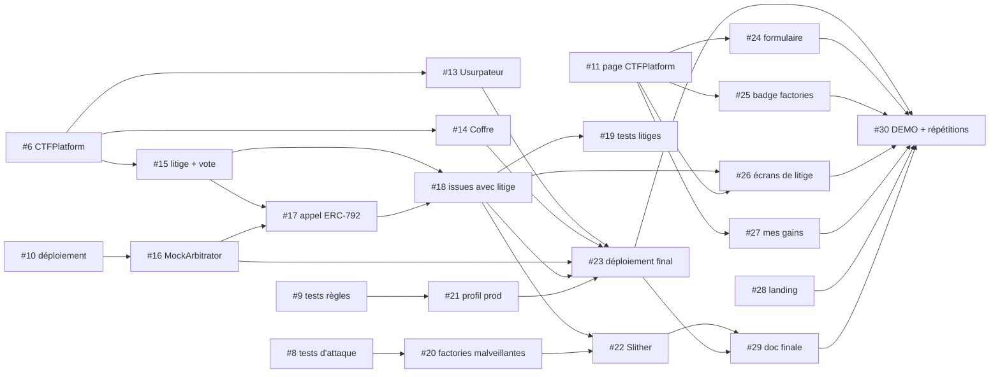

# Plan jusqu'au code freeze

Ce document dit où en est le projet, ce qui reste à faire jusqu'au **code freeze du vendredi 27 novembre**, dans quel ordre, qui le porte, et ce qu'on fait si quelque chose dérape. Il s'appuie sur les milestones GitHub « Soutenance intermédiaire » (7 novembre) et « Code freeze » (27 novembre).

> **Statut : proposition à valider en équipe.** La répartition ci-dessous n'est pas encore actée. Une fois validée, chaque responsable s'assigne ses issues sur GitHub.

## Sommaire

1. [Où on en est](#où-on-en-est)
2. [Ce qui reste jusqu'au code freeze](#ce-qui-reste-jusquau-code-freeze)
3. [Qui porte quoi](#qui-porte-quoi)
4. [Partage des connaissances](#partage-des-connaissances)
5. [Risques et plans B](#risques-et-plans-b)

---

## Où on en est

État au **5 novembre 2026**.

### Livré sur `master`

| PR | Contenu |
| --- | --- |
| #1 | Documentation du projet (README, DESIGN, CHALLENGES, SECURITY, DEMO) |
| #2 | Frontend : landing, page « explorer », pages légales, 404 / erreur, SEO, CI GitHub Actions |
| #3 | Décisions actées de l'équipe (gains, litiges, cautions) dans DESIGN.md |
| #4 | Catalogue des failles (`docs/FAILURES.md`) |

### En revue (PR ouvertes, empilées)

À merger **dans cet ordre** : chaque PR cible la branche de la précédente, et GitHub bascule la cible sur `master` quand la précédente est mergée.

| PR | Branche | Contenu | Issue |
| --- | --- | --- | --- |
| #37 | `feat/6-interfaces` → `master` | Interfaces `ILevel`, `IArbitrator`, `IArbitrable` (ERC-792), `ICTFPlatform` | #6 |
| #38 | `feat/6-ctfplatform` → `feat/6-interfaces` | `CTFPlatform` sans litiges : création, tickets, instances, `submit` en `staticcall` 300 000 gaz, podium, `finalize`, `claimRefund`, `withdraw` | closes #6 |
| #39 | `test/9-rules` → `feat/6-ctfplatform` | Un test de refus par règle (chaque custom error déclenchée), issues sans litige, conservation des fonds au wei près, fuzz | closes #9 |

### Codé mais sans PR

- Branche `feat/levels` (Victor) : les 3 épreuves (`Vault`, `Impostor`, `CodeSafe`), leurs factories, exploits et tests Solidity + TypeScript, module Ignition `Levels.ts`. Couvre l'essentiel de #7, #13 et #14 ; reste à ouvrir la PR et à brancher les épreuves sur `CTFPlatform`. Son `ILevel.sol` est identique à celui de #37.

### Déploiement

- **Rien n'est déployé sur Base Sepolia** : aucune adresse dans le README, pas de dossier `contracts/ignition/deployments/`. C'est l'objet de #10 puis #23.
- Frontend : projet Vercel rattaché à l'équipe de Victor. Les previews des commits poussés par un autre membre sont bloquées (compte non membre de l'équipe Vercel). Ce n'est pas un échec du code.

### CI

- GitHub Actions (`.github/workflows/ci.yml`), deux jobs : **Frontend** (Prettier, `pnpm lint`, `pnpm typecheck`, `pnpm build`) et **Contrats** (`pnpm contracts:build`, `pnpm contracts:test`, `pnpm contracts:typecheck`).
- **Verte** sur `master` et sur #37, #38, #39. Le profil `production` n'est pas encore testé en CI (#21).

### Reste du milestone « Soutenance intermédiaire » (7 novembre)

| Issue | Sujet | État |
| --- | --- | --- |
| #5 | Ce plan | cette PR |
| #6, #9 | `CTFPlatform` minimal, tests de règles | PR #37, #38, #39 en revue |
| #7 | Épreuve 3 « Coffre-fort à code » | codée sur `feat/levels`, sans PR |
| #8 | Tests d'attaque (réentrance, receiver, bombe à gaz) | à faire |
| #10 | Déploiement et vérification sur Base Sepolia | à faire |
| #11 | Page qui lit et écrit dans `CTFPlatform` | à faire |
| #12 | Relecture finale de la doc | à faire, en dernier |

Ce qui n'est pas fini le 7 passe en tête de la semaine du 9 novembre : #8, #10 et #11 bloquent une bonne partie du milestone suivant.

---

## Ce qui reste jusqu'au code freeze

Les 18 issues du milestone « Code freeze », dans l'ordre de leurs dépendances (section « Dépend de » de chaque issue). Une issue n'est planifiée qu'après celles dont elle dépend.

### Semaine du 9 novembre : fondations

| Issue | Sujet | Dépend de | Tranche |
| --- | --- | --- | --- |
| #13 | Épreuve 2 « Usurpateur » (`tx.origin`) + factory + tests | #6 | B |
| #14 | Épreuve 1 « Coffre » (réentrance) + factory alimentée + tests | #6 | B |
| #15 | Litige : ouverture et vote | #6 | A |
| #16 | `MockArbitrator` complet | #10 | A |
| #21 | Profil production vert et ajouté à la CI | #9 | C |
| #28 | Landing alignée sur les décisions actées | — | C |

### Semaine du 16 novembre : litiges et écrans principaux

| Issue | Sujet | Dépend de | Tranche |
| --- | --- | --- | --- |
| #17 | Appel et arbitrage ERC-792 | #15, #16 | A |
| #18 | Issues avec litige (triche confirmée, litige rejeté) | #15, #17 | A |
| #20 | Factories malveillantes restantes (+ revérification du `codehash`) | #8 | B |
| #25 | Confiance dans les factories (badge, `codehash`) | #11 | B |
| #24 | Formulaire de création d'un CTF | #11 | C |
| #27 | Page « mes gains » | #11 | C |

### Semaine du 23 novembre : sécurité, déploiement final, démo

| Issue | Sujet | Dépend de | Tranche |
| --- | --- | --- | --- |
| #19 | Tests de chaque issue avec litige, conservation au wei près | #18 | A |
| #26 | Écrans de litige | #11, #18 | A |
| #22 | Slither + revue des points d'entrée | #18, #20 | B |
| #23 | Déploiement final (toutes les factories, réel + démo) | #13, #14, #16, #18, #21 | C |
| #29 | Doc finale : figer la limite de gaz à 300 000, aligner la doc sur le code | #22, #23 | tous |
| #30 | DEMO.md final + deux répétitions sur Base Sepolia | #23 à #29 | tous |

**Chemin critique** : #15 → #17 → #18 → #22 / #23 → #29 → #30. Un retard sur les litiges décale le déploiement final et la démo : c'est le premier risque du tableau plus bas.

**Ordre de fin de semaine du 23** : #19 et #26 en début de semaine, #22 et #23 au plus tard le mercredi 25, #29 et la première répétition le jeudi 26, seconde répétition le vendredi 27.

---

## Qui porte quoi

Une **tranche verticale par membre** : chacun porte le contrat, les tests **et** l'écran de sa partie, pour pouvoir la défendre de bout en bout.

| Tranche | Responsable | Contrat + tests | Écran | Issues |
| --- | --- | --- | --- | --- |
| **A — Litiges** | Baptiste (`BaptisteMERY`) | Ouverture, vote, `MockArbitrator`, appel ERC-792, issues avec litige, tests de conservation | Écrans de litige | #15, #16, #17, #18, #19, #26 |
| **B — Épreuves et sécurité** | *Yann* | Épreuves 1 et 2, factories malveillantes, Slither | Badge de confiance des factories | #13, #14, #20, #22, #25 |
| **C — Production et parcours joueur** | Victor (`Victorbriez`) | Profil production en CI, déploiement final | Formulaire de création, « mes gains », landing | #21, #23, #24, #27, #28 |
| **Tous** | les trois | — | — | #29 (doc finale), #30 (DEMO.md + répétitions) |
| **Going further** | A ou B selon l'avancement | Tests d'invariants Foundry | — | #31 |

- **Going further : un seul axe**, les tests d'invariants (#31, les 6 invariants de [SECURITY.md](SECURITY.md#invariants)). Il dépend de #18 : il est pris par A si les litiges sont mergés avant le 23 novembre, sinon par B après #22. Les autres issues « Going further » (#32 à #36) ne sont pas planifiées.
- **Issues restantes de la soutenance intermédiaire** (si non finies le 7) : #7 et #8 → B, #10 et #11 → C, #12 → tous.
- **Revue croisée** : chaque PR est relue par un membre d'une autre tranche avant merge.

---

## Partage des connaissances

- **Avant chaque soutenance**, chaque membre explique sa tranche aux deux autres : le contrat, les tests, l'écran, et les choix faits (ce qui est dans la description de ses PR).
- **Le jury interroge chacun sur une partie qu'il n'a pas écrite.** Chacun doit donc pouvoir expliquer, sans notes, au moins : le flux d'argent d'un CTF (podium, aucun gagnant, triche confirmée), pourquoi `validateInstance` est appelé en `staticcall` avec une limite de gaz, et le déroulé d'un litige jusqu'à l'arbitre.
- La revue croisée des PR (voir plus haut) sert de première passe : on ne valide pas une PR qu'on ne saurait pas expliquer.

---

## Risques et plans B

Probabilité et impact : faible / moyen / élevé. Chaque plan B dit qui bascule et à partir de quand.

| Risque | Probabilité | Impact | Plan B |
| --- | --- | --- | --- |
| **Déploiement ou vérification qui échoue** (Ignition, Basescan, Sourcify) | moyenne | élevé | C fait un premier déploiement dès #10, sans attendre #23, pour essuyer les erreurs tôt. Si Basescan refuse la vérification, on vérifie sur Blockscout ou Sourcify (`ignition verify` les couvre) et on documente l'adresse. Si le déploiement complet échoue encore le **mercredi 25 novembre**, on démontre sur le déploiement de #10 et un nœud Hardhat local. |
| **Testnet ETH insuffisant** | moyenne | moyen | Chacun réclame de l'ETH Base Sepolia aux faucets dès la semaine du 9 et le regroupe sur le compte de déploiement dédié. Démo dimensionnée petit : cash prize de 0.001 ETH, ticket au minimum (0.0001 ETH), 3 joueurs. Si le **20 novembre** le compte n'a pas de quoi déployer + jouer deux répétitions, C réduit encore les montants et les durées. |
| **Factory non vérifiable sur Basescan** | moyenne | moyen | Le badge (#25, B) affiche alors « non vérifiée » et le `codehash` enregistré, ce qui est le comportement prévu par la décision n° 5. Pour la démo, B vérifie les factories sur Sourcify et le montre au jury ; à défaut, le code source est dans le repo et le `codehash` se compare à la main. |
| **Retard sur les litiges** | élevée | élevé | Point le **lundi 16 novembre** : si #15 n'est pas mergé, A passe aux **litiges simplifiés** : vote seul **sans appel** (on garde le timeout qui applique le vote). Si #17 n'est pas mergé le **vendredi 20**, A bascule sur l'**appel direct à l'arbitre** sans vote (contestation → `MockArbitrator` → `rule`). B reprend #26 (écrans de litige) pour libérer A. La limite est documentée dans SECURITY.md. |
| **Kleros absent de Base Sepolia** | élevée | faible | Assumé : `MockArbitrator` (#16) implémente `IArbitrator` (ERC-792), l'arbitre est un paramètre `immutable` du constructeur, donc Kleros se branche sans changer `CTFPlatform`. Dit tel quel au jury ; le vrai Kleros reste en « Going further » (#32). |
| **Conflit de merge entre branches empilées** (#37 → #38 → #39, `feat/levels`) | moyenne | moyen | Merger dans l'ordre, sans squash entre PR d'une même pile. Après chaque merge, l'auteur de la PR suivante la rebase sur `master` et pousse avec `--force-with-lease` (jamais `--force`, jamais sur la branche d'un autre). `ILevel.sol` est identique sur #37 et `feat/levels` : le conflit se résout en gardant une seule copie. Pas de PR empilée sur plus de 3 niveaux. |
| **Membre indisponible** | moyenne | élevé | Les tranches sont verticales et documentées dans les PR : un autre membre peut reprendre. Si un membre ne donne pas de nouvelles pendant **3 jours ouvrés**, ses issues non commencées sont réparties entre les deux autres, en priorité sur le chemin critique (A → B pour les litiges, B → A pour la sécurité, C → B pour le déploiement). Le going further (#31) est abandonné en premier. |
